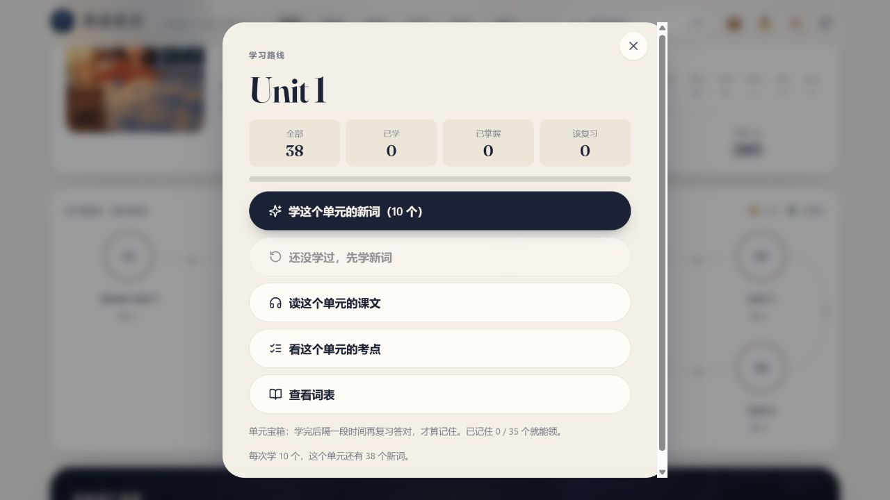
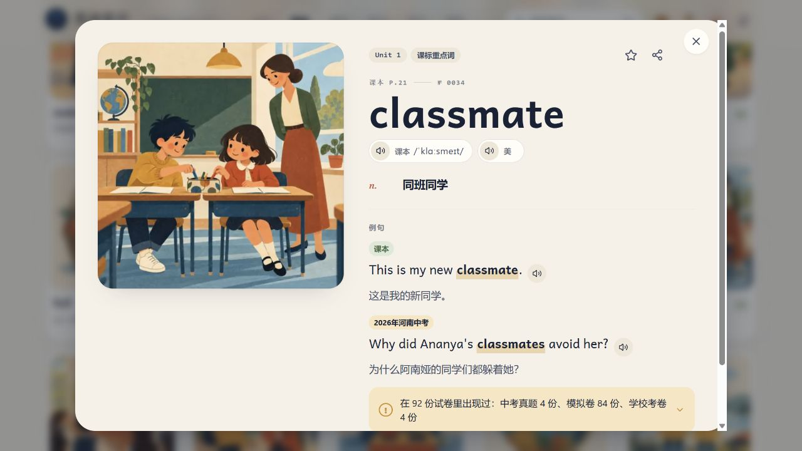
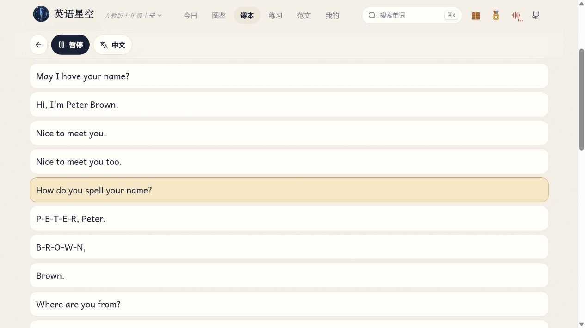
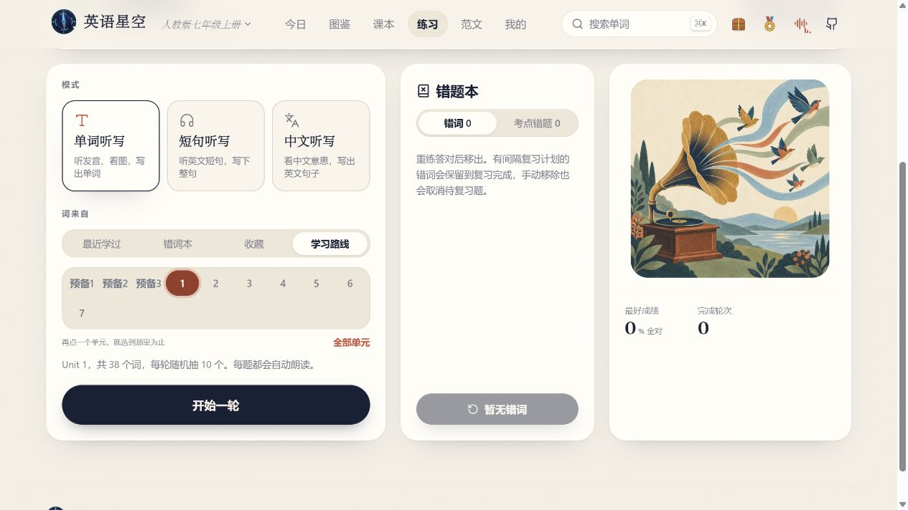
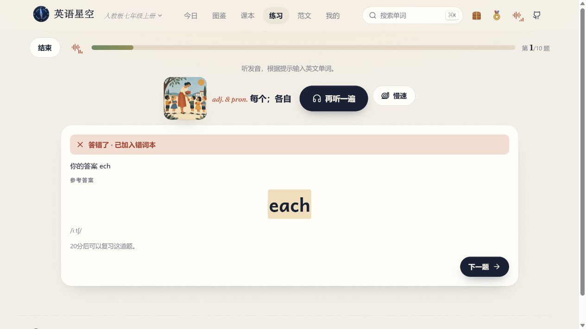

# 英语预习和复习，同一个单元怎么做？

*《把课本单词点成星》第 01 篇*

晚饭后，孩子打开英语书准备预习，翻了几页，问你：“我该从哪儿开始？”

等这一课上完，他又把词表看了两遍，说自己复习好了。合上书听写，明明眼熟的 `each`，落笔却少了一个字母。

这两个晚上，可以各做一件具体的小事。

> **明天要学的，今晚先听一遍。今天学过的，回家再练一轮。**

我是初中英语老师。我做「英语星空」，是想让学生放学回家后，自己也能找到课上那一单元的单词、录音和练习。家长第一次帮忙把册次选对，接下来孩子就可以自己点、自己听、自己练。

下面用**人教版七年级上册 Unit 1** 走一遍。你家孩子学到哪一课，就把示范中的 Unit 1 换成那一课。

## 上课前，先听几个词和一段对话

打开 [英语星空](https://eng.xaicloud.net/)。第一次看到登录页，点「游客进入」和「以游客身份进入」，按手边的教材选册，再点「自己选单元」和「出发」。

在「今日」页的「学习路线 · 课本单元」点 **Unit 1**。同一张单元面板上，有「查看词表」和「读这个单元的课文」两个入口。

**先看几个课本词。** 点「查看词表」，让孩子挑三个想听的词。比如 `classmate`，卡片上是一幅教室里的画。先问问孩子，画里这两个人可能是什么关系。再让他点发音，听听“同班同学”用英语怎么说。卡片下方还有标明出处的例句，可以顺手听一句。

**再点读一小段。** 回到 Unit 1 的面板，点「读这个单元的课文」，找到 **Section A · 1b**。这段对话里，有人问对方怎么拼写名字。让孩子自己点一句，听完跟读一遍。想连着听，可以点「整段播放」。

如果孩子只想听一句，就从一句开始。第二天老师读到那一段时，他能认出一个词、听出一句熟悉的话，这次预习就有了具体的落点。

## 下课后，合上书，听写同一个单元

还是七上 Unit 1。这次打开「练习」，选「单词听写」，在「词来自」里点「学习路线」，选中 **Unit 1**。看到下方只写着 Unit 1，就可以点「开始一轮」。七上这个单元每轮随机抽 10 个词。

听到发音后，孩子看着图和释义提示，自己输入英文。没听清可以点「再听一遍」。提交后，页面马上显示结果。

我在演示里把 `each` 输成了 `ech`。提交后，屏幕上显示了输入的答案和正确拼写。**这道题进了错词本，20 分钟后可以复习。** 下次回到「练习」，先看上方的「听写错题复习」，有到期的题就先练它。

如果孩子卡在课文的某一句，就回去点那一句。如果他听得出、写不对，就把这一轮留给听写。陪孩子看一眼练习结果时，可以问他：“刚才哪一个词，你想再试一遍？”

## 做完，让孩子去看看自己的星图

在 Unit 1 选「学这个单元的新词」，看图、听音，再做几道回忆题。我在演示里答对了 `make friends` 的回忆题，回到「今日」页打开星图，看到第一颗星已经点亮。

星图能看到哪些词学过，也区分「学习中」和「已掌握」。想学新词时可以继续点亮，到了该复习的时候，再回来试试自己还记不记得。

## 今晚就试一个单元

已经在首页的话，可以从顶部册名切换教材。

目前可选**人教 PEP 六年级上册、人教版初中五册**，另有**外研版九年级上册**。游客进度保存在当前设备的浏览器里，下次继续用同一设备和浏览器打开。

**今晚，让孩子自己挑三个词，点读一句下一课的课文。** 等上完这一课，回家再到同一个单元听写一轮。

*下一篇，我们用人教 PEP 六年级上册做一次课前预习。*
