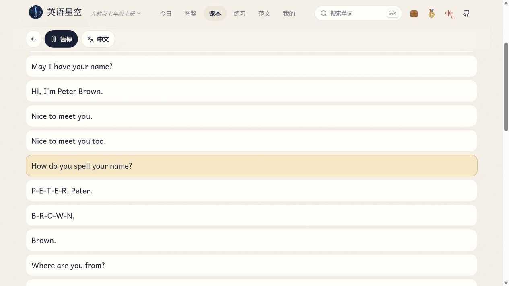

## 笔记正文

孩子翻开英语书问：「预习要做什么？」

我做了个可以按教材单元点读的网页，叫「英语星空」。第一次试，家长帮孩子找到明天要学的单元，接下来让他自己点。

我用**人教版七上 Unit 1** 演示了一遍。

1. **找单元。** 在「今日」的学习路线里点 Unit 1。
2. **听三个词。** 点「查看词表」，挑三个词看图、听音。比如 *classmate*，画里是教室里坐在一起的同学。
3. **点读一句。** 回到单元面板，点「读这个单元的课文」。打开 Section A · 1b，选一句听一遍，愿意就跟读一遍。

孩子已经学到别的课，就把 Unit 1 换成他正在学的单元。第一次碰到登录页，可以点「游客进入」先试。

**今晚挑三个词，点读一句课文。**

#英语预习 #课文点读 #初中英语 #人教版英语 #英语星空

---

## 五页配图顺序

| 页 | 图片叠字 | 对应截图 |
|---|---|---|
| 01 · 封面 | 明天要学的英语，今晚先听一遍 | 用 [classmate 单词卡](assets/04-单词插画.jpg) 左侧的教室插画 |
| 02 · 选册 | 先选孩子手边的那一册 | [选择册次](assets/01-选择册次.jpg)，配小字「游客进度只保存在当前浏览器」 |
| 03 · 找课 | 找到明天要学的单元 | [Unit 1 单元入口](assets/02-单元入口.jpg) |
| 04 · 听词 | 挑三个词，看图、听音 | [classmate 单词卡](assets/04-单词插画.jpg) |
| 05 · 点读 | 点一句，听一句 | [Section A · 1b 点读](assets/03-课文点读.jpg) |

发稿时使用已验证的 [英语星空体验入口](https://eng.xaicloud.net/)。
