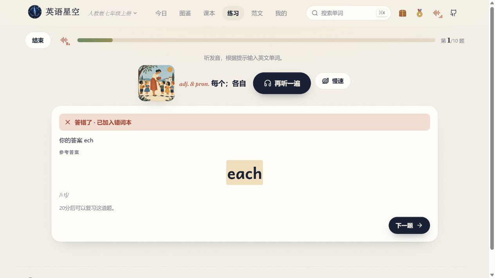

# 单词都眼熟，合上书会写吗？

## 正文

词表上看见 `each`，知道是「每个」。合上书听写，手一快，打成了 `ech`。

如果孩子英语复习总停在「词表看过了」，可以试一次**只练今天学过的单元**。

我用自己做的「英语星野」，拿人教版七上 Unit 1 演示了一轮。

1. 打开「练习」，选「单词听写」。
2. 在「词来自」里选「学习路线」，点 Unit 1。确认下面只显示这一个单元，再点「开始一轮」。
3. 听发音、看提示，自己写出来。没听清就点「再听一遍」。

我故意少打了一个字母。页面显示正确拼写，把这道题放进错词本，还提示 **20 分钟后可以复习**。下次打开「练习」，有到期的错题就先重做一次。

今晚试一轮就好。做完可以问问孩子，**哪个词你想再写一次？**

#英语复习 #单词听写 #错词本 #初中英语 #英语星野

## 配图顺序

| 页 | 叠字 | 实拍素材 |
|---|---|---|
| 1 | 单词都眼熟，合上书会写吗？ | 用 [听写反馈](assets/06-听写反馈.jpg) 里的 `ech → each` 对照做封面 |
| 2 | 选单词听写，只练今天这一单元 | [Unit 1 听写设置](assets/05-本单元听写.jpg) |
| 3 | 少一个字母，页面马上给反馈 | [听写反馈](assets/06-听写反馈.jpg) |
| 4 | 这道错题，到期再做一次 | [错词复习提示](assets/07-错词复习.jpg) |

发稿时使用已验证的 [英语星野体验入口](https://eng.xaicloud.net/)。
