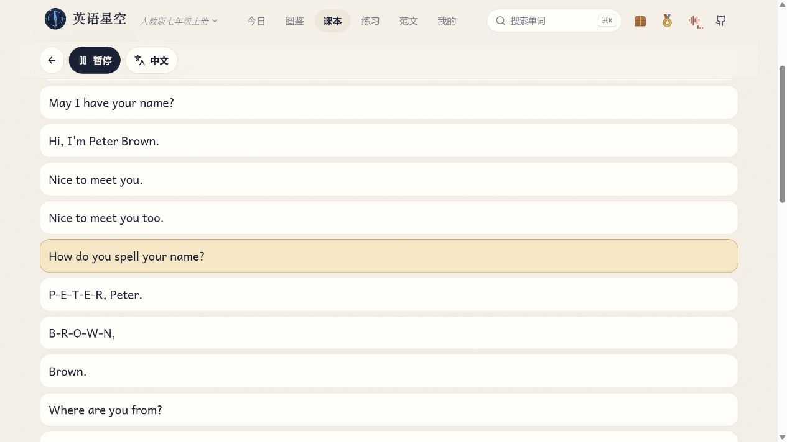
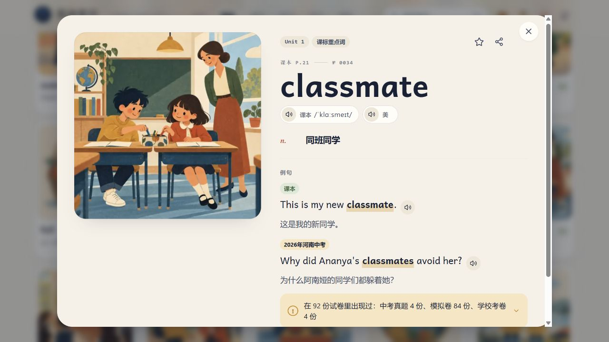
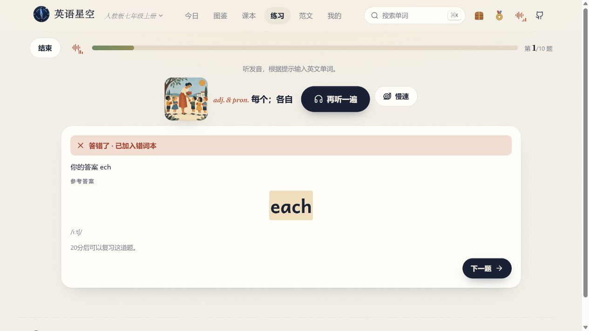
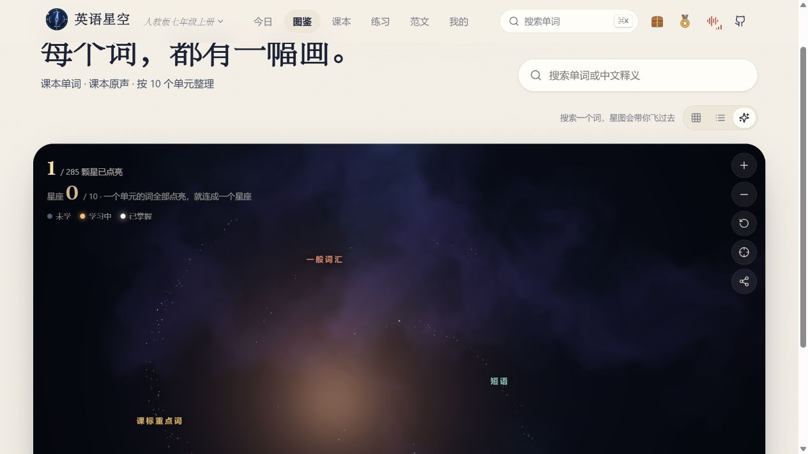

# 我挖到一个英语网站，课文可以一句一句听

*海淀普娃学生 · 我的英语宝藏网站*

听英语课文时，我最怕遇到这种情况。前一句还听得懂，后一句突然就连成一串了。

我把录音往回拖一点，它从上一段开始播。再往前拖一点，刚好跳过我想听的那句。最后，我对前一句已经熟得快会背了，后一句还是没听清。

所以我发现「英语星野」的时候，最先试的就是这个功能。**点课文上的哪一句，它就读哪一句。**

## 我终于点中了想听的那一句

我拿人教版七上 **Unit 1** 试了一下。Section A · 1b 是一段认识新朋友的对话。前面是打招呼，后面问名字怎么拼。我想听问名字的那句，就直接点它。

*点到哪一句，哪一句就亮起来。*

第一遍听声音，第二遍跟着说。等我想听整段了，再点「整段播放」。这样预习起来挺轻松。课本翻到哪一页，我就找那一课的录音。

还有一个我喜欢的小地方。单词卡上的图可以先猜。比如 *classmate*，图上是坐在一间教室里的两个同学。我脑子里先有了这张图，再去听发音。

*猜猜图里这两个人是什么关系，再点发音。*

我会先挑三四个词看一眼，然后回去听课文。碰到刚见过的词，有一种在路上遇到熟人的感觉。

## 少打一个字母，它会怎么判？

我拿 *each* 试了试。故意打成 *ech*，看看少一个 *a* 它会不会发现。这两个拼法挨着放，我才看清差在哪儿。

*少写了一个 a。系统把这道题放进了错词本。*

我喜欢这页会把我写的和正确的都摆出来，能直接看到差在哪。它还会告诉我，这道题 **20 分钟后可以再做**。过一会儿，或者下次打开的时候，我可以在「练习」里找「听写错题复习」。

听写也能只选一个单元。今天上的是 Unit 1，就在「练习」里选「单词听写」，再从「学习路线」里点 Unit 1。听不清可以再放一次，手指不用忙着拖进度条。

## 我学的词，真的在图上亮了

后来我去做了新词练习。答完 *make friends* 的回忆题，我退回「今日」，点开星图。刚开始是零颗，回来变成了一颗。

*我点亮的第一颗星。*

一颗星也挺好看的。我还点了「飞到一颗已点亮的星」，想看看自己刚才学的那个词躲在哪儿。

我现在准备这么用。明天要上的课，今晚先听一遍，听不清就挑一句再听。今天上过的课，回家把书一合，选那个单元练一轮。写错的，留给下一次来试。

## 想试的话，先翻到你明天要上的那一课

打开 [英语星野](https://eng.xaicloud.net/)。看到登录页，可以点「游客进入」，选你手边的教材和单元。网站有人教 PEP 六上、人教版初中五册，也有外研版九上。游客下次用同一台设备、同一个浏览器打开，可以接着看进度。

**第一次进去，先找一句你总听不清的课文。点它。** 这就是我觉得它是个宝藏网站的原因。
