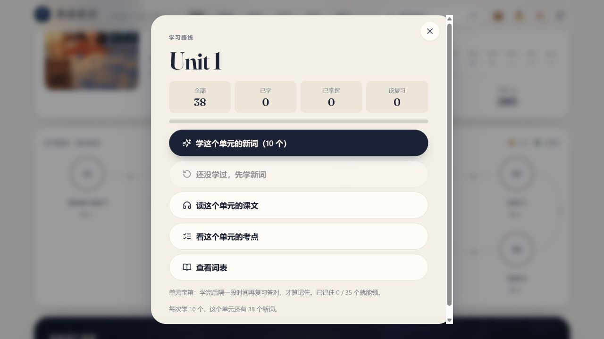
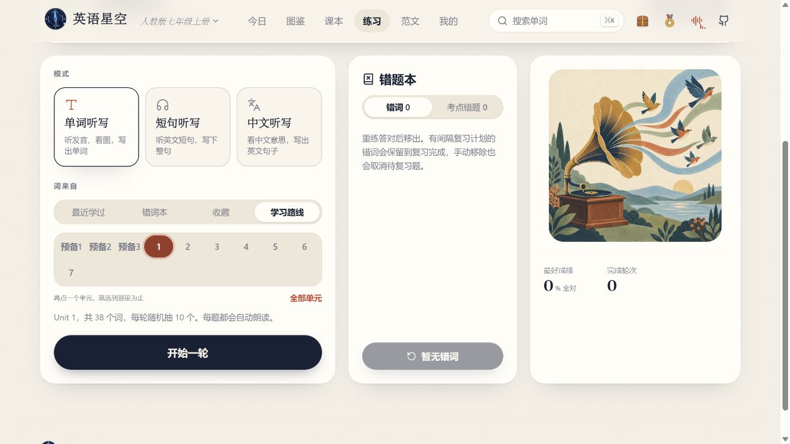

# 我用 AI 给孩子搭了个英语网站

*海淀普娃家长 · 把英语预习和复习放回课本*

家里复习英语，最容易卡在一句问话上。

「英语复习了吗？」

「看过了。」

书确实翻过，词表也确实看过。接下来我还是不知道该帮什么。是这课的录音听不清，还是单词看着认识，合上书就写不出来？如果每晚都靠我找录音、报听写、记错词，这件事就得等我有空才能开始。

我想把这一段做得简单一点。于是，我用 AI 帮忙，**基于开源项目「英语星空」搭了一个孩子在家就能打开的学习网站。** 孩子照着课本上的单元号，就能找到对应的内容。

## 我先把需求说成孩子能做的两件事

我把希望孩子能做的事告诉 AI。打开网页先选册，再选单元。课前能点读这一课，课后能只练这一课的词。放在家里，就是两句话。

> **明天要学的，今晚先听一遍。**
>
> **今天学过的，回家再练一轮。**

第一件事先把门槛降下来。孩子打开网页选好册次和单元，在同一张面板里就能找到词表和课文。不知道从哪开始，可以先挑三个词听听，找一句对话点一下。

第二件事是把书合上。上完课回家，打开「练习」，用「单词听写」再练同一个单元。当天哪几个词写不出来，页面上会给反馈。下次有到期的错题，孩子可以自己再做。

*以七上 Unit 1 为例，词表、课文和考点都从这张面板进去。*

我最想省掉的是来回找的时间。音频在哪里，词表在哪一页，今晚究竟练哪一课，最好都能用课本上的一个单元号说清楚。

## 用 AI 搭网站，得拿着课本验一遍

这次有一个现成的开源项目可以用。原作者是一位初中英语老师，和 AI 一起把教材里的词、音频和练习做成了网页。我请 AI 帮忙把项目搭到孩子能直接打开的地址上。网页能打开以后，我按家里实际会用的顺序试了一遍。

我拿的是**人教版七上 Unit 1**。先打开单元面板，看能不能找到课文。再去「练习」选同一个单元，检查页面是不是只从 Unit 1 抽词。只要多选了几个单元，屏幕上就会显示范围，家长跟着图也能检查。

*做课后听写之前，先看下方的范围是不是只有今天这一课。*

然后我故意把 *each* 输成 *ech*。页面马上给出正确拼写，把这道题收进错词本，还告诉我 **20 分钟后可以复习**。回到「练习」页，能看到 *each* 留在错词本里，也能看到下次复习的时间。

*做错以后，系统记着是哪道题，也记着什么时候可以再做。*

我现在回头看，给 AI 提要求，最管用的是先说清楚孩子在哪一步会卡住。比如「帮我搭一个英语学习网站」能做的事情太多，我家眼下需要的是「孩子能按课本找到今天这课，听写错了，下次还能找回这道题」。有了这句话，我就知道该打开哪几个页面去验。

## 第一次我帮他选，下一步让他自己点

如果第一次在家里用，我会先和孩子把手边的课本翻开，核对**版本、册次、单元**。剩下的可以交给他。挑哪三个词、要不要把那句再听一次，都让他自己选。

课后我也想换个问法。与其问「复习了没」，可以问「今天哪个词你想再试一次？」他能打开自己的错词本找出来，我们就有了一件说得清楚的小事。

还有一个孩子可以自己去看的地方是星图。做过新词练习，会看见有星星亮起来。图上把「学习中」和「已掌握」分开了。我喜欢它把今天学过一点这件事变得可见，也给孩子留了个下次打开的理由。

## 今晚从一句课文试起

打开 [英语星空](https://eng.xaicloud.net/)。第一次可以选「游客进入」，按孩子的教材选册，再选单元。现在有人教 PEP 六上、人教版初中五册，也有外研版九上。游客进度在当前浏览器里，想接着用就用同一台设备和浏览器打开。

**今晚，家长只帮着找到那一课。让孩子自己点一句，听完了就算开始了。** 等这一课上完，回到同一个单元，再练一轮。

*本站基于「英语星空 English Galaxy」开源项目搭建。原项目的界面和部分素材来自「词光 Word Atlas」。* [原项目](https://github.com/wenchester8-droid/english-starry-sky)
